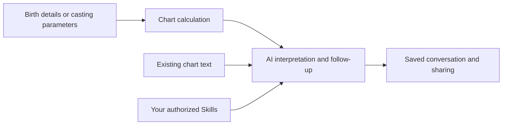
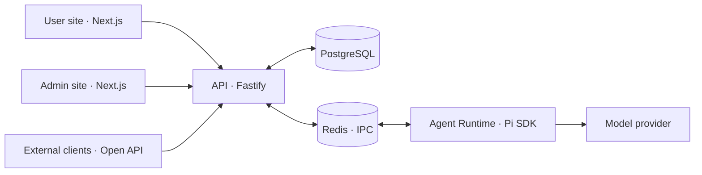
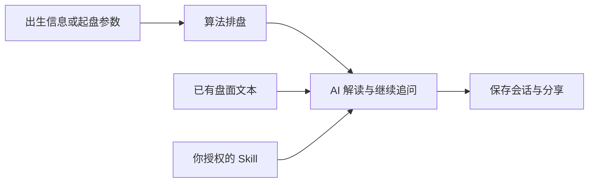
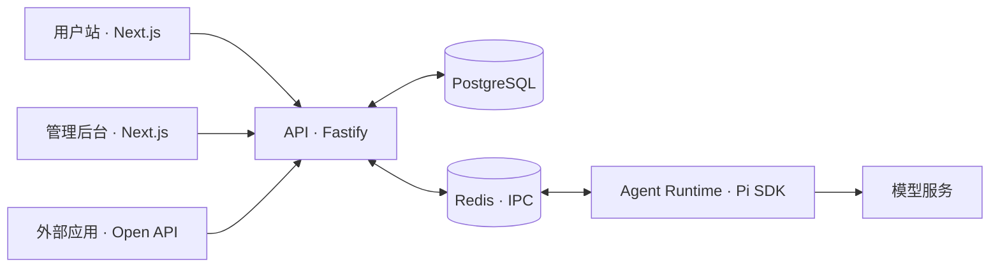

# FateClaw（命枢）

[English](#english) · [简体中文](#简体中文)

## English

FateClaw is an open-source Chinese metaphysics AI agent: a workspace for chart calculation, AI interpretation, and reusable personal knowledge. Use it to explore your own charts, organize readings for clients, or integrate chart calculation and Agent conversations into another application.

Chart data comes from local TypeScript algorithms. The agent reads that data, can consult your authorized Skills, and discusses the result with you. Chart calculation runs independently of the model; AI interpretation requires a configured model provider.

[Quickstart](#quickstart) · [Deployment](#deployment) · [Documentation](docs/README.md) · [Contributing](CONTRIBUTING.md)

### Supported charts

| System | What you can work with |
| --- | --- |
| Bazi | Four pillars, ten-year luck cycles, annual fortunes, and patterns |
| Ziwei Doushu | Twelve-palace star charts and fortune overlays |
| Liuyao Najia | Hexagrams, changing lines, six relationships, six spirits, and related chart data |
| Zhouyi Jingzhan | Dayan or simplified casting, specified hexagrams and lines, and text-selection rules |
| Meihua Yishu | Time, number, or trigram casting; primary, mutual, and changed hexagrams |
| Qimen Dunjia | Rotating and Mingfa flying charts, both using the Chabu ju method |
| Da Liu Ren | Calendar-based or specified monthly-general casting, four lessons, and three transmissions |

Charts appear as structured cards in the conversation, with full-screen reading and text copying. The [chart catalog and Open API reference](docs/open-api.md#chart-calculation) describe accepted parameters and outputs.

### From chart to conversation

You can start in three ways:

- **Calculate a chart yourself:** choose a system, enter the relevant birth details or casting parameters, preview the chart, then bring it into a conversation.
- **Ask the agent to calculate:** describe the chart you need in chat. The agent can ask for missing information and invoke the same chart calculations.
- **Bring an existing chart:** paste chart text from another tool, choose its category, and add your question.



For example, choose Bazi, enter a birth date and time, and preview the four pillars. After signing in, start an interpretation session and ask about a particular period or a point in the chart. Continue asking in the same session to retain its chart and conversation context.

### More than charting

| Capability | How it helps |
| --- | --- |
| Personal knowledge and Skills | Write Markdown Skills containing your methods and reference material for the agent to search and read. Publish or share Skills, subscribe to others, and organize them into Bundles. |
| Client records | Save birth details, tags, and client status; associate reading sessions with a client and keep follow-up notes. |
| History and sharing | Revisit saved conversations, archive them, or share a read-only conversation through a link and a downloadable poster. |
| Soul personalization | Explicitly maintain the persona and long-term preferences supplied to the agent. This is user-maintained context, not automatic cross-conversation learning. |
| Model and service management | Configure paid and free model pools, provider nodes, routing and failover, public prices, and usage through a separate admin app. |
| Open API | Use API keys to calculate charts and create stateful Agent sessions under `/api/v1`. See the [integration guide](docs/open-api.md). |

### Quickstart

#### Requirements

- Node.js **24** and the package-manager version pinned in `package.json` (**pnpm 11.5.0**).
- PostgreSQL and Redis. The included Docker Compose file provides PostgreSQL 18 and Redis 7 for local development.
- A model provider for AI interpretation. You can preview deterministic charts without a provider or a user account.
- The Aliyun Dypnsapi SMS integration for new account registration and password recovery. Registration currently requires a mainland China mobile number.

#### Start locally

```bash
git clone https://github.com/Coaixy/FateClaw.git
cd FateClaw
pnpm install
docker compose up -d
cp -n .env.example .env
```

Docker Compose starts **PostgreSQL and Redis only**. Edit the local `.env` before starting the apps:

| Setting | Purpose |
| --- | --- |
| `DATABASE_URL` | Connection to your local PostgreSQL database |
| `REDIS_URL` | Connection to your local Redis instance |
| `JWT_SECRET` | A strong random signing secret, at least 32 characters |
| `MANAGER_KEY` | A strong random admin key, at least 32 characters |
| `ALLOWED_ORIGINS` | Include `http://localhost:3001,http://localhost:3002` |

Account registration also needs the Aliyun Dypnsapi SMS settings `ALIYUN_SMS_ACCESS_KEY_ID`, `ALIYUN_SMS_ACCESS_KEY_SECRET`, and `ALIYUN_SMS_ENDPOINT`. See [local development](docs/development.md) and the [authentication reference](docs/api-reference.md#auth-endpoints).

```bash
pnpm run dev
```

| App | Local address |
| --- | --- |
| User site | http://localhost:3001 |
| Admin site | http://localhost:3002 |
| API | http://localhost:3000 |

Use a development database: API startup initializes or upgrades its schema automatically. The full `dev` command starts the API, user site, admin site, and the workers needed for AI Chat; lightweight development mode skips those workers.

Check database and Redis readiness:

```bash
curl --fail http://localhost:3000/api/ready
```

You can now open the user site and preview a chart. For an API example using fictional birth details, no login or model configuration is needed:

```bash
curl --fail http://localhost:3000/api/paipan/preview \
  -H 'Content-Type: application/json' \
  -d '{"skill":"bazi-paipan","input":{"solarDate":"1990-05-20","hour":10,"gender":"male"}}'
```

#### Complete your first AI reading

1. Open the admin site and authenticate with your configured `MANAGER_KEY`. This key is for administration, not a regular user login.
2. At `/system/models`, configure the official paid model pool: model, protocol, provider endpoint and credential, plus the platform's input/output token prices.
3. Register or sign in on the user site. For a new account, the SMS integration must be configured first.
4. Preview a chart and start an interpretation conversation, or paste an existing chart and a question. Check that the final reply appears and remains after refreshing the page.
5. Optionally configure and enable the separate free model pool at `/system/benefit-models`, including its daily allowance and concurrency.

Paid AI usage is billed by token and does **not** require membership; the wallet must not be in arrears. Non-members pay 1.5 times the configured member prices. The free model service is disabled by default and requires active membership when enabled; its configured allowance does not consume wallet credit. Users select platform models rather than entering personal provider keys. See [membership and billing](docs/membership-entitlement-current.md) and [free model service](docs/benefit-model-pool.md).

### Deployment

The user site and admin site are separate static exports. The API runs as a Node.js service and manages Agent Runtime processes. PostgreSQL stores application data and Skill revisions; Redis carries runtime queues and coordination.



After installing the locked dependencies, build deployment packages with the intended public API address:

```bash
NEXT_PUBLIC_API_BASE=https://api.example.com pnpm run pack
```

| Archive | Deploy as |
| --- | --- |
| `fateclaw-backend-v<version>-runtime.tar.gz` | API and compiled Agent Runtime |
| `fateclaw-www-v<version>-static.tar.gz` | User-facing static site |
| `fateclaw-admin-v<version>-static.tar.gz` | Admin static site |

Use the [deployment guide](docs/deployment-split.md) for runtime installation, persistent storage, origins, reverse proxy configuration, process management, and upgrades. Database upgrade behavior is documented in [database migrations](docs/database-migrations.md).

The retained WeChat/iLink integration is disabled by default, and the current user site has no account-binding page. It is not a ready-to-use onboarding path; see [integration status and requirements](docs/openclaw-integration.md).

### Documentation and contributions

| Need | Start here |
| --- | --- |
| Local setup and development commands | [Local development](docs/development.md) |
| Production installation and packaging | [Deployment](docs/deployment-split.md) |
| Agent execution, tools, and knowledge access | [Runtime architecture](docs/agent-architecture.md) |
| External chart and conversation integration | [Open API](docs/open-api.md) |
| Find the code for a change | [Agent guide](AGENT.md) |
| Browse all topic references | [Documentation index](docs/README.md) |

Contributions are welcome through the [contribution guide](CONTRIBUTING.md). Please follow the [Code of Conduct](CODE_OF_CONDUCT.md); report vulnerabilities through the [security policy](SECURITY.md).

FateClaw is for research and personal exploration. AI interpretations may be inaccurate and do not constitute professional advice.

Licensed under [GPL-3.0-only](LICENSE). See [NOTICE](NOTICE) for attribution. Copyright (C) 2026 Gavriel.

## 简体中文

FateClaw（命枢）是一个开源玄学 AI Agent，把排盘、AI 解读和个人术数知识放在同一个工作区。你可以研究自己的盘面、整理客户的解读记录，也可以把排盘和 Agent 对话接入其他应用。

盘面数据由本地 TypeScript 算法计算，Agent 读取这些数据，并可检索你授权的 Skill 作为解读参考，再与你继续讨论。排盘计算独立于大模型运行；AI 解读需要配置模型服务。

[快速开始](#快速开始) · [部署概览](#部署概览) · [项目文档](docs/README.md) · [贡献指南](CONTRIBUTING.md)

### 支持的排盘体系

| 体系 | 主要内容 |
| --- | --- |
| 八字 | 四柱、大运、流年和格局 |
| 紫微斗数 | 十二宫星盘及运限叠加 |
| 六爻纳甲 | 本卦、变卦、动爻、六亲、六兽及相关盘面数据 |
| 周易经占 | 大衍筮法、略筮法、指定卦爻及取辞规则 |
| 梅花易数 | 时间、数值或指定上下卦起盘，本卦、互卦、变卦与体用关系 |
| 奇门遁甲 | 转盘与鸣法飞盘，均采用拆补定局 |
| 大六壬 | 按时间或指定月将起课，四课、三传等课式数据 |

盘面以结构化卡片显示在对话中，支持全屏阅读和文本复制。各体系的参数和输出可查阅[排盘目录与 Open API 文档](docs/open-api.md#chart-calculation)。

### 从排盘到解读

你可以从三种方式开始：

- **手动排盘：**选择体系，填写出生信息或起盘参数，预览盘面后带入解读会话。
- **对话排盘：**直接告诉 Agent 需要排什么盘，由它补问缺失信息并调用相同的排盘能力。
- **自贴盘面：**粘贴其他工具生成的盘面文本，选择类别，并附上自己的问题。



例如，选择八字，填写出生日期和时间，先预览四柱。登录后开启解读会话，询问某个阶段或盘面中的具体关系，再在同一会话中继续追问，沿用已有盘面和对话上下文。

### 排盘之外的能力

| 能力 | 可以做什么 |
| --- | --- |
| 个人知识库与 Skill | 用 Markdown 编写自己的判断方法和参考资料，供 Agent 检索、阅读；支持发布、链接分享、订阅，以及用 Bundle 组合多个 Skill。 |
| 客户档案 | 保存出生资料、标签和客户状态，关联解读会话，并记录后续跟进。 |
| 历史与分享 | 回看、归档已有对话，通过链接分享只读会话，也可以下载分享海报。 |
| Soul 个性化 | 主动维护提供给 Agent 的人格和长期偏好；这是用户维护的上下文，不代表自动跨会话学习。 |
| 模型与服务管理 | 通过独立后台配置付费和免费模型池、供应节点、路由与故障切换、公开价格，并管理用量。 |
| Open API | 使用 API Key，通过 `/api/v1` 调用排盘和有状态 Agent 会话，详见[接入文档](docs/open-api.md)。 |

### 快速开始

#### 环境要求

- Node.js **24**，以及 `package.json` 固定的包管理器版本：**pnpm 11.5.0**。
- PostgreSQL 和 Redis；仓库的 Docker Compose 提供本地开发用的 PostgreSQL 18 与 Redis 7。
- AI 解读需要模型服务；确定性排盘预览无需配置模型，也无需用户账号。
- 新账号注册和找回密码需要阿里云号码认证短信服务（Dypnsapi）；当前注册使用中国大陆手机号。

#### 本地启动

```bash
git clone https://github.com/Coaixy/FateClaw.git
cd FateClaw
pnpm install
docker compose up -d
cp -n .env.example .env
```

Docker Compose **只启动 PostgreSQL 和 Redis**。启动应用前，编辑本地 `.env`：

| 配置项 | 用途 |
| --- | --- |
| `DATABASE_URL` | 本地 PostgreSQL 数据库连接 |
| `REDIS_URL` | 本地 Redis 连接 |
| `JWT_SECRET` | 至少 32 字符的高强度随机签名密钥 |
| `MANAGER_KEY` | 至少 32 字符的高强度随机管理密钥 |
| `ALLOWED_ORIGINS` | 包含 `http://localhost:3001,http://localhost:3002` |

账号注册还需配置阿里云号码认证短信相关项：`ALIYUN_SMS_ACCESS_KEY_ID`、`ALIYUN_SMS_ACCESS_KEY_SECRET` 和 `ALIYUN_SMS_ENDPOINT`。详细说明见[本地开发指南](docs/development.md)和[认证接口文档](docs/api-reference.md#auth-endpoints)。

```bash
pnpm run dev
```

| 应用 | 本地地址 |
| --- | --- |
| 用户站 | http://localhost:3001 |
| 管理后台 | http://localhost:3002 |
| API | http://localhost:3000 |

请使用开发数据库：API 启动时会自动初始化或升级数据库结构。完整的 `dev` 命令会启动 API、用户站、管理后台和 AI Chat 所需的工作进程；轻量开发模式会跳过这些工作进程。

检查数据库和 Redis 是否就绪：

```bash
curl --fail http://localhost:3000/api/ready
```

此时可以打开用户站预览盘面。下面也提供一个使用虚构出生资料的 API 示例，无需登录或配置模型：

```bash
curl --fail http://localhost:3000/api/paipan/preview \
  -H 'Content-Type: application/json' \
  -d '{"skill":"bazi-paipan","input":{"solarDate":"1990-05-20","hour":10,"gender":"male"}}'
```

#### 完成第一次 AI 解读

1. 打开管理后台，使用配置的 `MANAGER_KEY` 登录。它用于管理操作，不是普通用户账号。
2. 在 `/system/models` 配置官方付费模型池，包括模型、协议、上游地址与凭据，以及平台输入、输出 Token 价格。
3. 在用户站注册或登录；新用户注册前，需要先完成短信服务配置。
4. 预览盘面并开启解读会话，或粘贴已有盘面和问题。确认最终回复能够显示，并且刷新页面后仍然存在。
5. 如需提供免费模型服务，再到 `/system/benefit-models` 单独配置节点、每日次数与并发，并启用服务。

付费 AI 按 Token 计费，**不要求会员**，但钱包不能处于欠费状态；非会员按配置会员价的 1.5 倍计费。免费模型服务默认关闭，启用后需要有效会员，并受后台配置的额度限制，不消耗钱包积分。普通用户选择平台提供的模型，不自行填写上游 Key。详见[会员与计费](docs/membership-entitlement-current.md)和[免费模型服务](docs/benefit-model-pool.md)。

### 部署概览

用户站和管理后台分别构建为静态站点；API 作为 Node.js 服务运行，并管理 Agent Runtime 进程。PostgreSQL 保存业务数据和 Skill 修订，Redis 负责运行时队列与协调。



安装锁定版本的依赖后，指定生产 API 公网地址并生成部署包：

```bash
NEXT_PUBLIC_API_BASE=https://api.example.com pnpm run pack
```

| 部署包 | 内容 |
| --- | --- |
| `fateclaw-backend-v<version>-runtime.tar.gz` | API 与编译后的 Agent Runtime |
| `fateclaw-www-v<version>-static.tar.gz` | 用户站静态文件 |
| `fateclaw-admin-v<version>-static.tar.gz` | 管理后台静态文件 |

运行包安装、持久化目录、跨域、反向代理、进程管理和升级步骤见[部署指南](docs/deployment-split.md)。数据库升级规则见[数据库迁移](docs/database-migrations.md)。

仓库保留的微信 / iLink 集成默认关闭，当前用户站也没有账号绑定页面，尚不能作为开箱即用的接入方式；具体状态和要求见[集成说明](docs/openclaw-integration.md)。

### 文档与贡献

| 需求 | 入口 |
| --- | --- |
| 本地安装、配置和开发命令 | [本地开发](docs/development.md) |
| 生产安装和打包 | [部署指南](docs/deployment-split.md) |
| Agent 执行、工具和知识库读取 | [运行时架构](docs/agent-architecture.md) |
| 外部排盘与对话接入 | [Open API](docs/open-api.md) |
| 查找修改对应的源码 | [Agent 指南](AGENT.md) |
| 浏览全部专题文档 | [文档索引](docs/README.md) |

欢迎按照[贡献指南](CONTRIBUTING.md)参与项目，并遵守[行为准则](CODE_OF_CONDUCT.md)。安全问题请通过[安全政策](SECURITY.md)中的渠道反馈。

FateClaw 仅供研究和个人探索。AI 解读可能存在错误，不构成专业建议。

采用 [GPL-3.0-only](LICENSE) 许可证，署名信息见 [NOTICE](NOTICE)。版权所有 (C) 2026 Gavriel。
