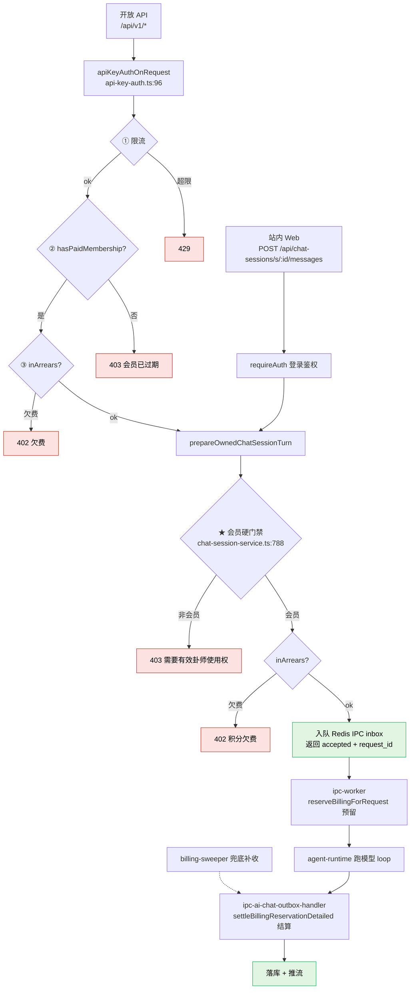

# 会员权益与 AI 解读门禁（当前事实）

最近核对：2026-06-29。

> 本文是会员/权益/AI 解读计费的**单一事实来源（SSOT）**，以**当前代码**为准。
> 历史方案 `membership-tier-migration.md`（四档迁移）与 `api-membership-billing-cleanup.md`
> （四档计费清理）记录的是中间阶段的设计，**已被"单层化"重构取代**，不再反映现状。

## 一句话结论

**AI 解读（站内 + 开放 API）必须是有效会员才能发起，没有任何免费额度或试用次数；会员发起后仍按 token 用量扣积分，欠费会被拦截。**

## 单层化：现在只有一个会员档

旧的 Free / Clarity / Insight / Deep 四档体系**已废弃**。迁移 `0058` 已把所有历史
`plan_key`（`fateclaw_plus`、`fateclaw_pro`、`fateclaw_insight`、`fateclaw_deep` 等）
全量归一为 `clarity`。

- 在售套餐只有一个：**Clarity**（`fateclaw_clarity`）。
- 会员被抽象为二元的"**卦师使用权**"：`membershipActive` 有效 / 无效。
- 归一逻辑收敛为"非 clarity 即回落 clarity"——见 `apps/api/src/shared/membership-plans.ts:8`。

### 当前能力矩阵

| 能力 | 无会员 | 有效会员（Clarity） |
| --- | --- | --- |
| 手动排盘（本地确定性，不走 AI、不计费） | 可用 | 可用 |
| **AI 解读 / 追问（站内 AI Chat、自贴盘面、简易模式）** | **不可用（403）** | 可用，按 token 扣积分 |
| 开放 API `/api/v1/*` | 不可用（403） | 可用，按 token 扣积分 |
| runtime 优先队列 | 否 | 是（`hasPriorityQueue = membershipActive`） |
| 微信 Claw | 不可用 | 不可用（被总开关 `WECHAT_CLAW_FEATURE_ENABLED = false` 关停） |

> All model calls use the platform-managed official model. `hasPriorityQueue` equals `membershipActive`.
> 微信 Claw 由 `entitlements.ts:25` 的集中常量关停（数据层迁移 `0057` 已 `accounts.enabled=false` 双保险）。

## AI 解读门禁

`getRuntimeEntitlementSnapshot()`（`apps/api/src/modules/billing/entitlements.ts:58`）
是统一权益快照，门禁只消费其布尔字段。AI 解读有两个入口，各自一道硬拦截：

### 1. 站内 Web 链路

- 路由：`POST /api/chat-sessions/s/:sessionId/messages`（`chat-sessions-routes.ts`，`requireAuth` 登录鉴权）。
- service：`sendOwnedChatSessionMessage` → `prepareOwnedChatSessionTurn`。
- **硬门禁**：`apps/api/src/modules/chat/chat-session-service.ts:788`

  ```ts
  if (!entitlement.membershipActive) {
    return fail(403, MEMBERSHIP_REQUIRED_MESSAGE); // "需要有效的卦师使用权才能发起解读，请先开通或续费"
  }
  if (entitlement.wallet.inArrears) {
    return fail(402, BILLING_ARREARS_MESSAGE);     // "积分已欠费，请补充积分后继续使用"
  }
  ```

- 注释明确：**AI Chat、自贴盘面、简易模式三条入口都收口到这里统一硬拦截**。
  （旧文档里"简易模式首轮 Free 可 bypass"的 `professionalAiQuotaBypass` 路径已删除，
  `simple-workflow-service.ts` 文件本身也已不存在。）

### 2. 开放 API 链路

- 域：`/api/v1/*`（`open-api-routes.ts`，`onRequest: apiKeyAuthOnRequest`）。
- **鉴权 + 门禁**：`apps/api/src/interfaces/http/api-key-auth.ts:96` 起，顺序为：
  1. Bearer key 校验（缺失/无效/过期 → 401）。
  2. 按 key 限流（`openapi:{keyId}`，超限 → 429）——**刻意排在权益校验之前**，避免持合法 key 但会员过期者零限流地反复触发带行锁的权益写事务（已鉴权资源耗尽）。
  3. `!entitlement.hasPaidMembership` → 403「会员已过期，请续费后继续调用 API」（`:154`）。
  4. `entitlement.wallet.inArrears` → 402「账户积分欠费」（`:163`）。

> ⚠️ 一致性隐患：站内用 `membershipActive`，开放 API 用 `hasPaidMembership`。单层化下两者等价，
> 但开放 API 调 AI 解读会**先后过两道**（api-key-auth 的 `hasPaidMembership` + service 的 `membershipActive`）。
> 若未来重新引入档位，这两个布尔会分叉，需同步收敛。

### 排盘特例

手动排盘是本地确定性计算，**不走 AI、不计费**。站内手动排盘不经过上述解读门禁；
但开放 API 域的排盘接口仍要先过 `apiKeyAuthOnRequest`（即仍需有效会员 + 不欠费）。

## 计费：预留 → 结算两阶段（metered）

会员**没有免费额度**（`plans.ts:77`「单层化后会员不含 AI 免费额度」），AI 解读全部按实际
token 用量计费：

1. **预留**：`reserveBillingForRequest()`（`ipc-worker.ts:735` / `1072`，仅 `billingMode='metered'` 时预留）。
2. **结算**：请求完成后 `settleBillingReservationDetailed()`（`ipc-ai-chat-outbox-handler.ts:264`），按真实 prompt/completion token 实扣。
3. **兜底**：`billing-sweeper.ts` 对预留行停在 `charge_state='pending'`（请求取消/超时/进程重启丢失内存 pending）的情况，按对话日志真实 usage 幂等补结算。
4. **欠费拦截**：`wallet.inArrears`（`available_coins = max(0, purchased + bonus - reserved) ≤ 0`）→ 402。

## 端到端调用图



## 关键代码索引

| 主题 | 文件:行 |
| --- | --- |
| 权益快照 | `apps/api/src/modules/billing/entitlements.ts:58` |
| 站内会员硬门禁 | `apps/api/src/modules/chat/chat-session-service.ts:788` |
| 开放 API 会员门禁 | `apps/api/src/interfaces/http/api-key-auth.ts:154` |
| 单层化归一 | `apps/api/src/shared/membership-plans.ts:8` / `:79` |
| 无免费额度 | `apps/api/src/modules/billing/plans.ts:77` |
| 计费预留 | `apps/api/src/runtime/ipc-worker.ts:735` / `:1072` |
| 计费结算 | `apps/api/src/runtime/ipc-ai-chat-outbox-handler.ts:264` |
| 计费兜底 | `apps/api/src/runtime/billing-sweeper.ts` |
| 微信 Claw 总开关 | `apps/api/src/modules/billing/entitlements.ts:25` |
