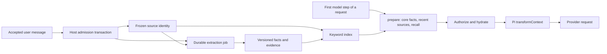

# Cross-conversation memory

FateClaw keeps durable memory in PostgreSQL and supplies authorized excerpts to Pi only while preparing a provider request. A new conversation can reuse relevant facts without inheriting another conversation's transcript. The user-facing controls are at `/memory`; platform policy and diagnostics are at the owner-only admin `/system/memory` page.

Soul is separate from memory. It is the persona the user maintains by hand in `users.soul_content`, and it enters the system prompt as the `<fateclaw_persona_override>` block exactly as before memory existed. Automatic extraction never reads or rewrites it, and clearing memory never changes it.

## Data flow and ownership

The host owns identity, permissions, source access, writes, jobs and accounting. The runtime owns the model loop and the temporary provider projection. Model tool arguments cannot select an owner, actor, audience or memory namespace.

User admission stores the message, its frozen memory scope, a source record and the extraction job in one transaction, so learning does not depend on the assistant replying. Admission rejects a turn only when the session is missing, the channel metadata lacks the speaker identity, or the identity changed after the turn was prepared (409 `MEMORY.PREPARATION_CHANGED`). Other memory state never fails it: an archived client, an inactive speaker binding or a subject the speaker may not use only turns learning and recall off for that turn. Admission takes no lock on the memory root.

Model calls run outside row locks. Applying their output locks the memory root and checks the job lease, the scope epoch, the speaker binding revision, the source version and hash, and the current account and conversation learning switches. Late or revoked work ends as a durable skipped/cancelled job. Workers use the existing platform model resolver and its opaque credential source.

## Durable records

| Record                                                               | Responsibility                                                                                          |
| -------------------------------------------------------------------- | ------------------------------------------------------------------------------------------------------- |
| `memory_scopes`                                                      | Account root and sender scopes: actor, audience, binding, switches, `epoch`, `binding_revision`         |
| `memory_entities`                                                    | Discussed person: account owner, client, sender or unresolved historical identity                       |
| `memory_sources`                                                     | Immutable attribution and reference to a versioned user message or an explicit manual entry             |
| `memory_items`                                                       | Facts, preferences, events, plans and decisions with a version family, observation time and validity    |
| `memory_evidence`                                                    | Exact source quote, version, hash and original character range supporting an item                      |
| `memory_index_entries`                                               | Rebuildable keyword chunks for items and sources                                                        |
| `memory_jobs`                                                        | Extraction and explicit history import with leases, retry state and retention                           |
| `memory_exclusions`                                                  | Forgotten assertions, redacted quote ranges and excluded source identities                              |
| `memory_tool_results`                                                | Idempotent receipts for model write tools                                                               |
| `memory_usage`, `memory_daily_budgets`, `memory_budget_reservations` | Platform memory-call accounting and crash reconciliation                                                |
| `pi_session_contexts`                                                | Initialization and generation for each business session and model-context audience                     |

Sources and facts are authoritative; the keyword index can be rebuilt. Source text is read from its owning message when needed, and an index hit alone never authorizes disclosure.

`epoch` advances when memory is cleared and invalidates all earlier work. `binding_revision` advances when a sender's identity binding changes. Settings, items and bindings also carry an ordinary `revision` used for compare-and-swap edits, which return `409` on conflict.

Extraction keeps exact, complete source statements. It preserves negation, attribution and uncertainty, distinguishes a plan from a completed event, and rejects questions, hypothetical examples, hearsay and assistant text as evidence. First-person statements refer to the actual speaker, even in a conversation about a client. Ambiguous historical identity stays unresolved. Each candidate is checked separately: a refused candidate is counted by reason code in the job payload (`rejectedCandidates`) and the others still apply. A user message of at most 40 characters that directly follows an assistant reply to the same audience is sent with the last 300 characters of that reply as `previousAssistant`, so "1990年" can be read as an answer. That text is context only: evidence still comes from the user's words, and a bare confirmation such as "对" is refused. Single-valued intake facts use the keys `birth_date`, `birth_time`, `gender` and `birthplace`; a newer value supersedes the older one, and core recall shows them first. Hedged statements such as "可能" are kept verbatim; opening conditions ("如果…"), hypotheses, hearsay and quoted speech are refused.

Repeated facts merge their evidence. A newer automatic statement with the same fact key can supersede an older automatic statement; observation order prevents a delayed old job from replacing a newer fact. Each space and subject has at most one active value per fact key. A different automatic assertion about a manual or explicitly remembered value is kept as `disputed`, with its evidence, and is excluded from provider recall. Repeating a disputed assertion merges its evidence. Explicitly remembering an existing automatic item protects it from later automatic replacement. Direct edits use revision checks, and conflict resolution never rewrites source messages. Complete, unambiguous self statements can supply a fact key for manual entries too; a workplace or duty is not treated as a single-valued profession.

## Identity and channel isolation

Four identities have separate meanings: account owner, actual speaker, discussed person, and audience allowed to read the result. A client selected in the conversation does not turn the operator's first-person statements into client facts.

- Web requests use the account owner's canonical memory space.
- An unknown WeChat sender has a separate actor, audience, source history and memory space. Owning the bound WeChat account does not identify every sender as the owner.
- The owner can bind a sender to the owner or an active client. Binding identifies future statements; sharing existing subject memory is a separate switch. Historical sources keep their original identity.
- A sender bound to the owner **and** granted sharing uses the owner's canonical facts and counts as the owner audience. Source attribution still records WeChat as the origin.
- A shared sender reads only the owner's root space and its own scope, never another sender's private scope. Cross-actor source access reveals only current supporting quote ranges. A read grant does not permit editing the owner's records.
- Open API requests have memory learning, recall and mutation disabled. Their `openapi:` sessions keep their own ordinary model history, and the caller's `system` text remains a request persona.

`read_soul` is offered only to the owner audience, and `edit_soul` additionally requires the Soul chat-editing switch. Tool reads and writes carry the admitted request and execution IDs. The database locks the memory root and active request and rechecks the current binding, owner audience, cancellation and context generation; writes also recheck the current Soul editing switch under the user-row lock. A committed revocation therefore blocks a subsequent write without waiting for the daemon heartbeat. Other audiences still receive the Soul persona in the system prompt.

The same boundary applies to ordinary Pi history, tools, compaction, recovery and session boards. File keys and durable frame chains include the audience and generation, and a nonempty audience never falls back to the owner file. Guests receive only resources with matching frozen actor attribution; legacy resources without sufficient attribution are owner-only.

Binding changes cancel old actor work and reset that sender's separate context while preserving the owner's web history. A global context reset advances a business reset revision, and every audience lazily moves to a new generation. An uninitialized generation starts fresh; an initialized context missing its file must restore a matching durable snapshot or return `410`.

## Retrieval and provider context

On the first model step of a request the runtime sends one `prepare` call with the user query and the references persisted by earlier memory tool results in the conversation. The host answers in a read-only transaction under the `recall_timeout_ms` deadline with:

- core facts: the subject's active facts, intake keys first, then by kind and most recent observation;
- recently accepted user statements whose extraction has not finished, from other conversations;
- keyword recall for the query: words of two or more characters plus every bigram of a Han run, matched with `ILIKE` over the reader's own entries and ranked by the number of matched terms;
- the supplied references, keeping the newest when there are more than `recall_max_results × 3`.

Every reference is re-authorized against current item, evidence and exclusion state before its text is returned, and the result is cut to the `recall_token_budget`, estimated as one token per non-ASCII character and per three ASCII characters. The budget is spent in this order: the first `recall_max_results` core facts, keyword recall, recent statements, supplied references, then the remaining core facts. The runtime reuses that result for later steps, retries and pool failover until a successful in-request write invalidates it. `search_memory` and `get_memory_source` return text in the same tool call and add it to the request's excerpts. If any memory call fails or times out, the turn continues without memory.

Memory text exists only in the cloned provider context built by `agent.transformContext`. Tool results in session files, snapshots and compaction input keep references, and a compaction extension strips memory text before summarizing. When there are no excerpts, nothing is added to the provider context; otherwise one block is placed immediately before the latest user message.

A forget or recall change made through `/memory` while a request is running takes effect from the next request. A successful `remember_memory`, `update_memory` or `forget_memory` call clears the request's excerpts, including source pages and family aliases, and refreshes authorization before the next provider step. Remember and update also read the committed item immediately. Replies started before invalidation cannot restore old text. Explicitly corrected and disputed supporting statements are masked in the provider's source projection while their original messages and management evidence remain available. Automatic value changes retain their historical sources, labelled as statements from that time rather than current values. Complete pending self statements that conflict with a protected single-valued fact are also withheld from recall. Disabling or forgetting memory cannot retract text already sent to a provider or written by the assistant. Use context reset when the model conversation must also start without its previous transcript.

## User controls and forgetting

The three account switches control automatic learning, model recall, and memory editing through chat independently of each other and of the Soul editing switch. Owner management remains available when recall or learning is off. Each conversation also has a learning switch. Turning a learning switch off cancels pending and running extraction for its scope in the same transaction, and switching it back on does not revive cancelled jobs. Existing saved facts remain until edited or forgotten.

`/memory` supports subject/source/status filtering, direct add/edit/forget, original evidence, source exclusion, sender binding and sharing, per-conversation learning, history import progress and pause/resume.

`remember_memory` can cite only a user message of the current conversation, audience and speaker binding, so a model cannot attach text from another conversation. It still works when the conversation's learning is off, because the user asked to save that statement.

Forgetting an item follows its version and merge lineage, excludes every historical hash and key at the cutoff, masks every occurrence of its supporting quote in the source text, revokes overlapping unsupported evidence and removes its index entries. Pending extraction cannot recreate a forgotten item. Unrelated statements in the same message remain usable. Excluding one source preserves facts that still have another valid source, and its exclusion identity survives physical deletion of the source row.

Clearing memory advances the epoch and cancels old jobs; it never changes Soul. `reset_context` also advances ordinary conversation generations and cancels active requests. User, client and source deletion cascades through the memory records.

## History import and operations

History import is an explicit action with optional conversation, source, client and time filters. It keeps a durable cursor, processes bounded batches of user messages, and supports pause/resume. Import never reassigns known historical speakers; unattributed legacy messages stay unresolved and do not supply automatic user facts. Import skips Open API sessions and WeChat messages whose sender has no memory scope yet. Unresolved history is recalled only for the owner audience and only in conversations linked to the same client, or to none. An explicit import can authorize a source captured while conversation learning was off, but the account learning switch must allow it, and turning that switch off cancels the import.

Defaults are two worker slots, a 45-second job timeout, three attempts, 40 messages per import batch and a daily budget of 1,000,000 estimated tokens. Policy validation requires one extraction reservation (input plus output tokens) to fit in the daily budget. The budget is one platform-wide UTC-day total. Claims persist each account's last served time and prefer ready accounts served least recently across batches; within a batch each selected account receives one slot before another slot goes to the same account. Concurrent claimers skip locked accounts. Messages that cannot carry a statement, such as greetings, punctuation or a single question without a first-person clause, are recorded without a model call. Memory calls are accounted separately from chat billing. Reservations precede model calls, settlement is idempotent, and recovery charges uncertain consumption at its reserved bound. Job errors and logs keep codes and metadata, never memory bodies.

Every hour the worker removes, in bounded batches: succeeded, skipped and cancelled jobs after 7 days; failed jobs after 30 days; per-call usage after 90 days (daily totals remain); settled reservations and tool receipts after 7 days; and the raw-text index of extracted sources after 90 days. Sources, facts, evidence and exclusions are never pruned, and a fact stays searchable after its source text leaves the index. The memory worker starts in the full API entry point `apps/api/src/app/index.ts`; `dev-api.ts` intentionally omits background workers.

## Deployment

Deploy API, agent-runtime, web, admin and contracts together. Migration `0102_cross_conversation_memory` adds the schema and seeds existing accounts with automatic learning **off**; new accounts inherit the platform default, initially **on**. The migration does not scan conversations with a model. It runs in one transaction with a 5-second `lock_timeout`: if a long transaction holds `chat_sessions`, `agent_requests`, `runtime_config` or `messages`, the migration fails and API startup stops instead of queueing every later query behind it; start the API again once the table is free. Building the new `agent_requests` index reads that table once and blocks its writes while it runs. There is no down migration, so take a backup first; older application code ignores the added tables and columns. The old first-account Soul fallback is copied once into the user Soul when the user Soul is empty, and the original account data is retained.

Migration `0103_memory_reliability` adds persisted search labels and account scheduling timestamps. It backfills labels and unambiguous fact keys in batches of 200 without a model call, retains one active value per key (manual/explicit first, then newest observation), and marks other values disputed before enforcing uniqueness. It removes their item index entries and preserves the original statements and evidence. Schedule a maintenance window: its table locks remain held for the migration transaction, including the existing-item scan and index creation. Batching limits memory use, not lock duration; runtime depends on memory volume.

Memory runs on the existing `postgres:18-alpine` service and needs no extension. Trigram indexes do not serve two-character Chinese terms, so keyword recall scans the reader's own index entries. No embedding model or vector extension is used.

Queued legacy requests without a frozen memory identity are not resubmitted after upgrade; host recovery and the daemon inbox reject them and ask the user to resend. Already generated durable results are still delivered, and possibly started requests keep the existing interrupted/unknown-usage recovery policy.

## Interfaces and validation

Shared DTOs and the signed RPC contract live in `packages/contracts/src/memory/` and `packages/contracts/src/agent/memory.ts`. API owners are `apps/api/src/modules/memory/`; request admission owns source capture. Runtime adapters are `apps/agent-runtime/src/memory-client.ts`, `pi-runtime/memory-context.ts` and `pi-runtime/tools/memory-tool.ts`. See the [HTTP reference](api-reference.md#memory).

Opt-in PostgreSQL regressions run against an explicitly disposable local `memory_test` database: set `FATECLAW_TEST_TEXT_MEMORY_DATABASE_URL`, `FATECLAW_TEST_MEMORY_DATABASE_URL` and `FATECLAW_TEST_MEMORY_SCOPES_DATABASE_URL` to it. They cover admission, model-output application with synthetic providers, recall, cross-channel canonical updates, actor and client isolation, late revocation, forgetting, leases, budgets, import and deletion. These checks do not establish real-provider extraction accuracy or production latency.

## Upstream design references

These projects informed the design; FateClaw keeps its own host/runtime boundary and does not depend on them:

- [Mem0](https://github.com/mem0ai/mem0): memory creation and retrieval as explicit application operations.
- [LangGraph](https://github.com/langchain-ai/langgraph): separation of conversation state from persistent memory across sessions, with durable execution.
- [Letta](https://github.com/letta-ai/letta): stateful agents with managed memory.
- [Graphiti](https://github.com/getzep/graphiti): provenance and temporal validity of changing facts, represented relationally here.
